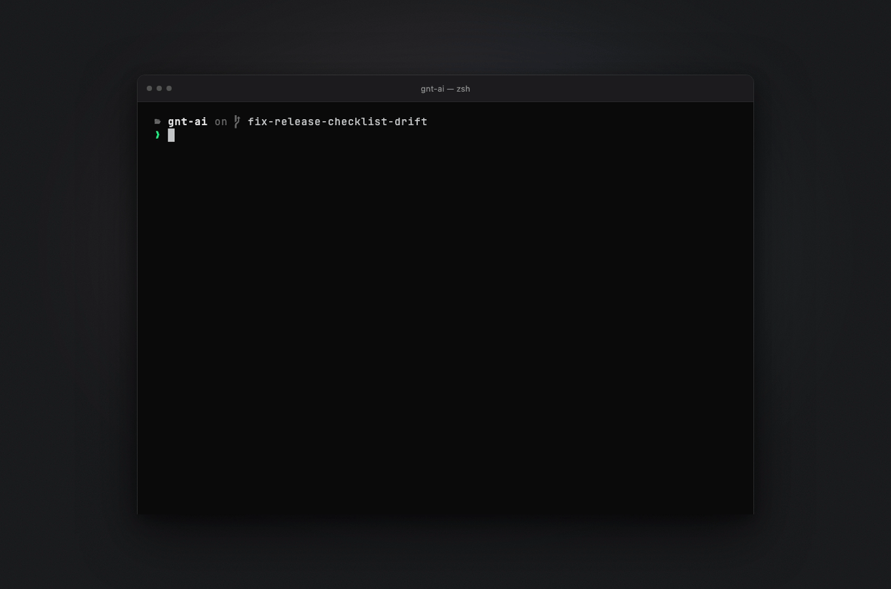

# gnt

gnt.ai from your terminal. Connect the apps your team already uses, propose rules as pull
requests against your own repo, query the brain — no dashboard required.



## Install

```
npm install -g @gnt-ai/cli
```

## Usage

```
gnt login              # opens your browser once, stores an API key locally
gnt connect slack       # connect a Slack workspace
gnt connect github      # connect the repo rules PRs open against
gnt status              # see what your brain knows
gnt review              # review in-review rules, propose PRs or reject
gnt pull                # download the latest compiled skill pack
```

Credentials are stored in `~/.gnt/credentials.json` (chmod 600), never in plaintext anywhere
else. Every command after `login` is fully terminal — the only browser tabs you'll ever see
again are the one-off consent screens for connecting a new app (Slack, etc.), not a dashboard
you work in.

## Configuration

gnt is self-hosted. The CLI talks to a local stack at `http://localhost:8000` (API) and
`http://localhost:3000` (web) by default. Point it at another deployment with:

```
GNT_API_URL=https://gnt.example.com
GNT_WEB_URL=https://app.gnt.example.com
```
